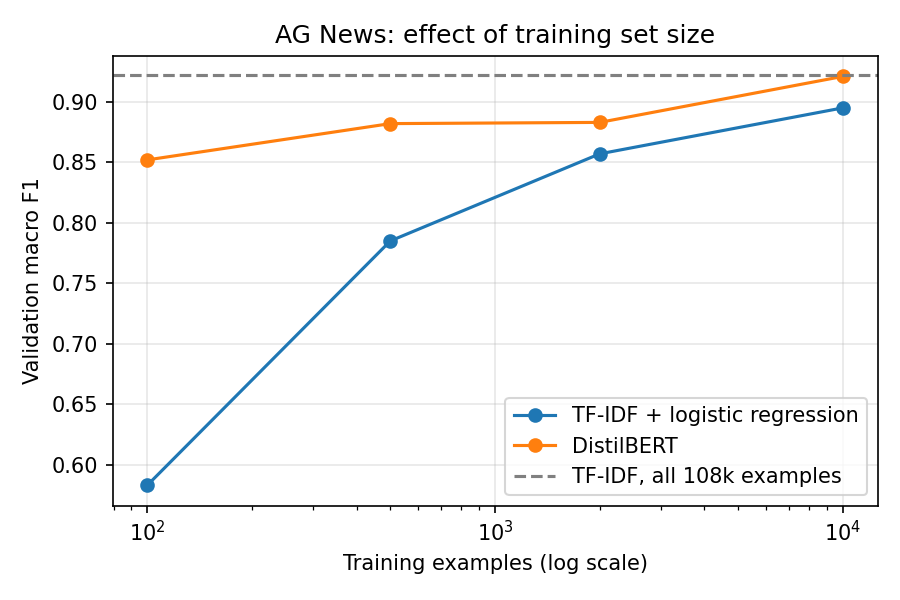

# AG News Topic Classification: TF-IDF vs DistilBERT, with Learning-Curve and Typo-Robustness Analysis

A comparison of a TF-IDF + logistic regression baseline and a fine-tuned DistilBERT on the four-topic AG News dataset (World, Sports, Business, Sci/Tech). Besides accuracy, the project looks at per-class errors, how much training data each model needs, and how both models cope with typos.

## Summary

Test set (7,600 examples, used once at the end):

| Model | Training examples | Accuracy | Macro F1 |
|---|---|---|---|
| TF-IDF + logistic regression | 108,000 | 0.9182 | 0.9179 |
| TF-IDF + logistic regression | 20,000 | 0.8975 | 0.8971 |
| DistilBERT (fine-tuned) | 20,000 | 0.9225 | 0.9223 |

- On identical training data (20,000 examples), DistilBERT is 2.5 accuracy points ahead of TF-IDF.
- DistilBERT trained on 20,000 examples is roughly level with TF-IDF trained on 108,000 (a 0.4 point gap, which could be noise with one seed).
- DistilBERT's advantage is large with very little data (27 F1 points at 100 examples) and shrinks to about 2 to 3 points from 2,000 examples upward.
- DistilBERT lost more F1 than TF-IDF under synthetic typos, and its advantage disappears at 30% typos.
- The hardest confusion, Business vs Sci/Tech, is not fixed by the stronger model.

## Data

- AG News (Hugging Face: `fancyzhx/ag_news`): 120,000 training and 7,600 test examples, four balanced classes, with headline and description joined in one text field.
- A stratified 90/10 split of the training data (seed 42) gave 108,000 training and 12,000 validation examples. The official test set was not touched until the final evaluation.
- Leakage check: no exact duplicate texts inside the training set, and none shared between train and validation or test. Near-duplicates were not checked.
- The 20,000-example subset used for the main comparison takes 5,000 examples per class from the training split (seed 42). Both models use exactly the same subset.

## Methods

**TF-IDF + logistic regression.** Word unigrams and bigrams, lowercase, minimum document frequency 2, at most 200,000 features, scikit-learn logistic regression with default regularization (max 1000 iterations). The vectorizer is fitted on training text only. No hyperparameter search.

**DistilBERT.** `distilbert-base-uncased` with a 4-way classification head, texts truncated to 64 tokens, AdamW (learning rate 3e-5, weight decay 0.01), batch size 32, 2 epochs, seed 42, no learning-rate schedule. The epoch with the best validation macro F1 was kept (epoch 2). Trained on a single T4 GPU.

Settings were chosen once and not tuned.

## Results

### Per-class F1 (validation set)

| Class | TF-IDF 108k | TF-IDF 20k | DistilBERT 20k |
|---|---|---|---|
| World | 0.919 | 0.906 | 0.930 |
| Sports | 0.967 | 0.952 | 0.972 |
| Business | 0.894 | 0.872 | 0.890 |
| Sci/Tech | 0.909 | 0.882 | 0.908 |
| Macro average | 0.922 | 0.903 | 0.925 |

On equal data (20k), DistilBERT is ahead on every class. Compared with the 108k baseline, it is ahead on World and Sports and level on Business and Sci/Tech.

### Error analysis

The most common validation errors:

| True class | Predicted as | TF-IDF 108k | DistilBERT 20k |
|---|---|---|---|
| Business | Sci/Tech | 200 | 265 |
| Sci/Tech | Business | 164 | 138 |
| World | Business | 113 | 123 |
| Business | World | 105 | 59 |
| World | Sports | 90 | 75 |

Business vs Sci/Tech accounts for 364 of the 931 TF-IDF errors (about 39%). DistilBERT makes 403 errors on that pair, so the stronger model does not resolve it.

I read 15 randomly chosen TF-IDF errors and judged 10 as genuine errors, 3 as ambiguous and 2 as possibly mislabelled. Most of those were business or legal stories about the technology and internet industry (a supercomputer announcement, file-sharing lawsuits, internet taxes), where either label is defensible. These samples are small and the judgments are mine, so they indicate a pattern and do not estimate error rates.

### Learning curve

Validation macro F1, random training subsets (3 seeds averaged up to 2,000 examples, 1 seed at 10,000):

| Training examples | Epochs (DistilBERT) | TF-IDF F1 | DistilBERT F1 | Gap |
|---|---|---|---|---|
| 100 | 10 | 0.583 | 0.852 | 0.269 |
| 500 | 5 | 0.785 | 0.882 | 0.097 |
| 2,000 | 3 | 0.857 | 0.883 | 0.026 |
| 10,000 | 2 | 0.895 | 0.921 | 0.026 |

Pretraining helps most when labelled data is scarce. DistilBERT with 10,000 examples (0.921) reaches the validation F1 of TF-IDF trained on 108,000 (0.922), in this single run. The DistilBERT score barely moves between 500 and 2,000 examples, which may be because 3 epochs is too few updates at that size. This was not tested.

### Typo robustness

Random swaps of two neighbouring inner letters in words longer than 3 letters, applied to validation text only (seed 42):

| Model | Clean F1 | 15% of words | 30% of words | Drop at 15% | Drop at 30% |
|---|---|---|---|---|---|
| TF-IDF 108k | 0.9222 | 0.9121 | 0.9057 | 0.0101 | 0.0165 |
| TF-IDF 20k | 0.9031 | 0.8909 | 0.8845 | 0.0122 | 0.0186 |
| DistilBERT 20k | 0.9252 | 0.9022 | 0.8850 | 0.0230 | 0.0402 |

DistilBERT degraded about twice as much as TF-IDF, and at 30% typos it is no better than TF-IDF on the same training data. One possible reason is that misspelled words split into unfamiliar word pieces, while TF-IDF only loses the affected features. This was not tested.

## Limitations

- One training run per model and one seed (apart from the three seeds averaged for small learning-curve sizes), so small gaps may be noise.
- The 108k and 20k TF-IDF models, and the DistilBERT run, used no hyperparameter tuning. TF-IDF's default regularization may hurt it at very small training sizes, which could inflate the gap at 100 examples.
- Learning-curve epochs differ by size (10, 5, 3, 2), so the comparison across sizes is not fully controlled.
- DistilBERT's epoch was selected on validation macro F1, so validation scores are slightly optimistic. Test scores are not affected.
- Typos are synthetic letter swaps at two severities, not real typing errors, and the models were not trained on noisy text.
- Texts were truncated at 64 tokens for DistilBERT. HTML codes in the data (such as `#39;`) were not cleaned.
- Only exact duplicates were checked, not near-duplicates.
- Class labels in AG News can be ambiguous, which puts a ceiling on achievable accuracy.
- Error samples were read and categorized by one person, with small sample sizes.

## Reproducing

1. Open `ag-news-tfidf-vs-distilbert.ipynb` in Google Colab or Kaggle with a GPU.
2. Run the notebook top to bottom. The dataset downloads automatically, and the split and subset use fixed seeds.
